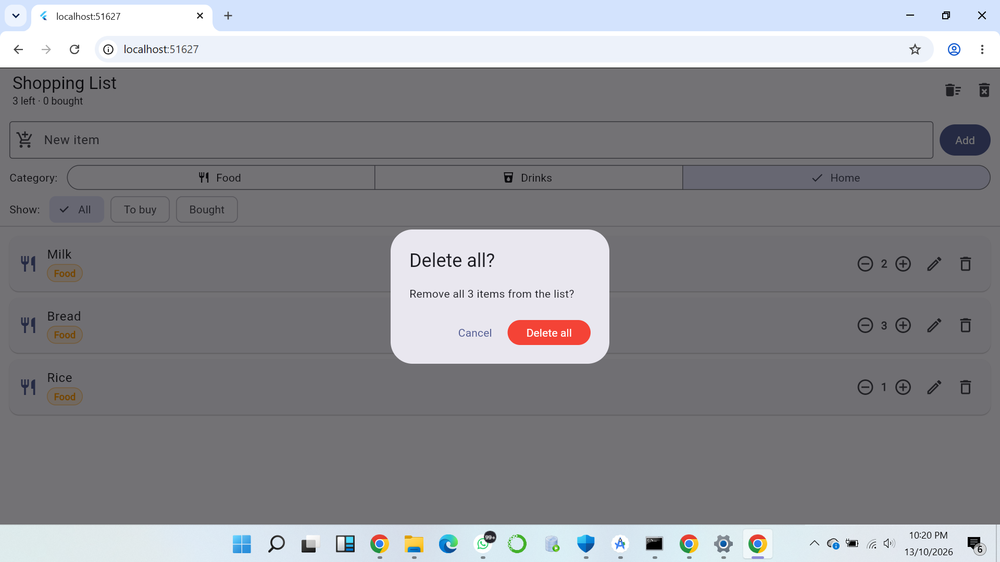
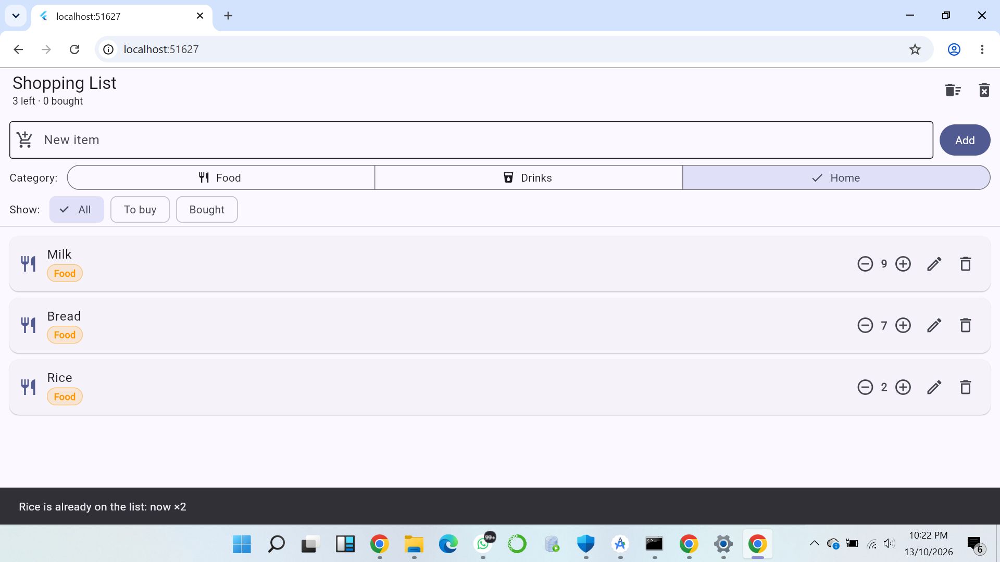
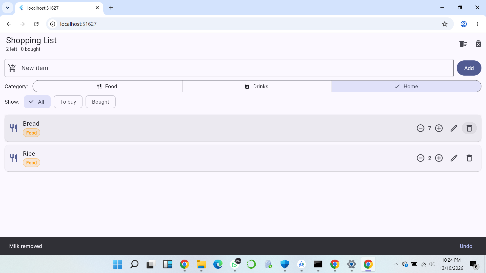
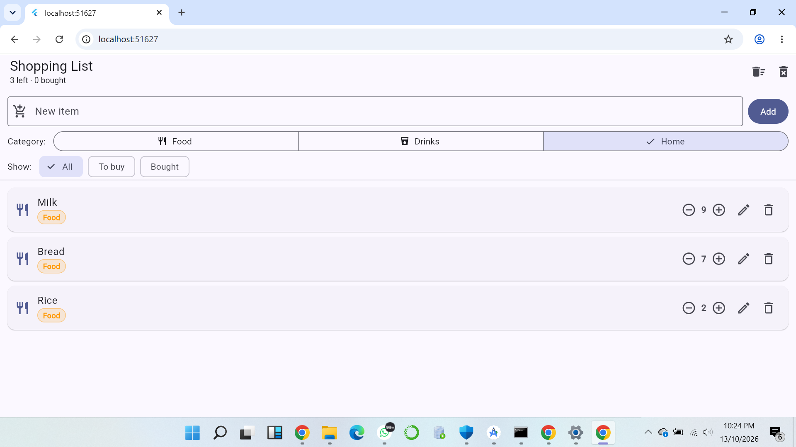
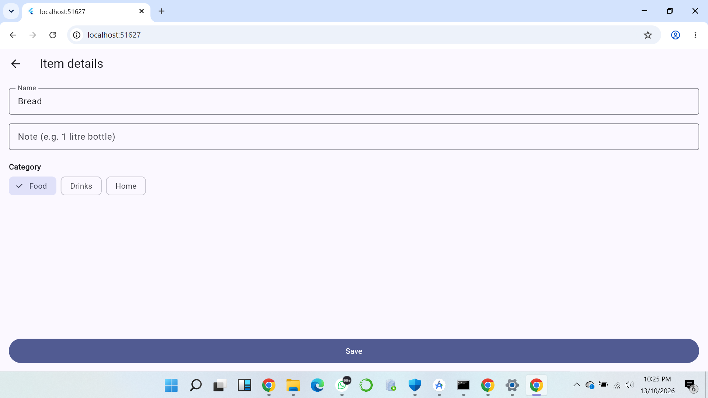

# Shopping List+

My second Flutter app: a shopping list with quantities, filters, undo, and a details screen.

Built on top of my original Shopping List app (Week 2, Session 3). This version adds the six upgrades from the Shopping List+ assignment.

## Features

1. **Nothing to show** — when the list has no items, the page shows *Your list is empty* instead of a blank screen.
2. **How many?** — every item starts at 1 with − and + buttons on its row. − never goes below 1; the bin removes the item.
3. **No duplicates, just more** — adding "milk" when "Milk" exists raises the existing item's quantity and shows a message, instead of creating a second row.
4. **Oops: undo** — deleting an item shows a snackbar with an **Undo** button, which puts the item back in its original position.
5. **Show me what's left** — All / To buy / Bought chips. In All, bought items sit at the bottom. When a filter has nothing to show, the page says *Nothing here*.
6. **Item details** — long-pressing an item opens a separate screen where I can edit its name, note, and category. Saving returns to the list, and the back arrow discards changes.

Extra features I kept from my first version:
- Edit dialog (pencil icon on each row) — quick rename + category change.
- Swipe to delete.
- Category chips (Food / Drinks / Home) with icons and colors.
- Delete all + Clear bought items in the top bar.

## Think

**1. In part 5, why does deleting by index remove the wrong item when a filter is on? How did you fix it?**

When a filter is active, the visible list is a subset of the real list. Row 0 on screen might be item 2 in the underlying list. Deleting by screen-index removes the wrong item silently. I fixed it by removing the item itself (`items.remove(item)`) instead of `items.removeAt(index)` — the object identity is always correct regardless of filter.

**2. Why did you have to remove `final` from `name`? Why is `final` still a good choice for most fields?**

`final` means "set once, never changed". The details screen and edit dialog both change `name` after the item is created, so it can no longer be final. `final` is still right for fields that never change after creation — it prevents accidental edits and lets the compiler catch bugs.

**3. Why did you need a hot restart after adding quantity to `Item`, when a save was enough for everything else?**

Hot reload keeps the app's current data (the live list of items). The old data had no `quantity` field. Hot reload can't inject a new field into existing objects, so I had to hot restart to rebuild the list from scratch with the new `Item` class.

**4. The details screen changed the item, but the list only showed it after `setState` in `.then`. Why? What does this tell you about how Flutter decides when to redraw?**

Flutter only redraws when `setState` is called. The details screen mutated the item object directly, but the list's `State` had no idea anything changed. `Navigator.push(...).then((_) { setState(() {}); })` runs `setState` when the user returns, telling Flutter "redraw the list". This shows Flutter doesn't watch data for changes — I have to tell it when to redraw.

## Screenshots

### Nothing to show — empty list message

### How many? — quantities with − and +

### No duplicates — Milk raised to ×2

### Oops: undo — Undo button after delete

### Show me what's left — Bought filter

### Item details — second screen
